# Assignment 2 — Ad-Hoc Automation on Azure: 4 VMs, Inventory & Passwordless SSH

Part of the DevOps Micro Internship (DMI) Cohort 3 with Agentic AI

---

## Purpose

In this assignment, you will provision four Azure Linux VMs with Terraform, configure passwordless SSH, build a custom Ansible inventory with web/app/db groups, and run ad-hoc commands across individual hosts and groups.

---

# Task 1 — Provision 4 Azure VMs (Terraform)

## Goal

Provision four Ubuntu 22.04 VMs (`web1`, `web2`, `app1`, `db1`, Standard_B1s) with SSH key authentication and public IPs, in a VNet with an NSG allowing SSH (22) and HTTP (80), and output all four public IPs.

### Evidence

#### Screenshot 1 — Terminal showing successful `terraform apply` output and `terraform output public_ips`

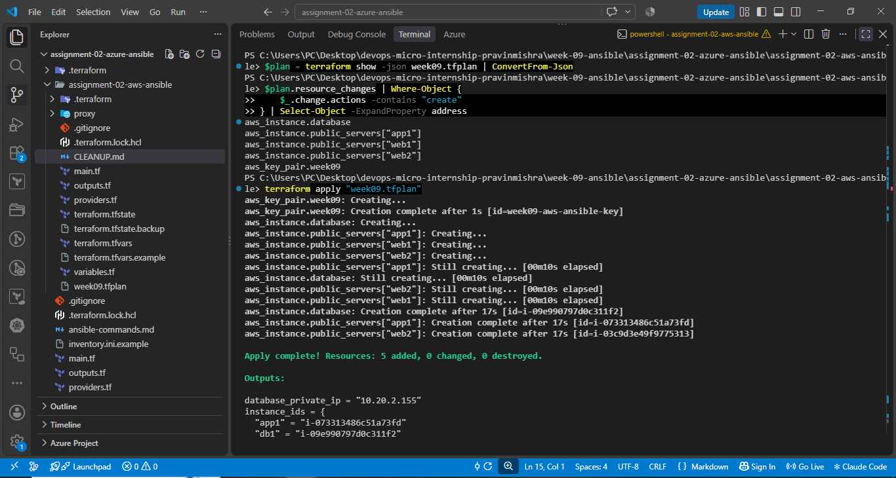

---

#### Screenshot 2 — Azure Portal showing all four running Ubuntu VMs

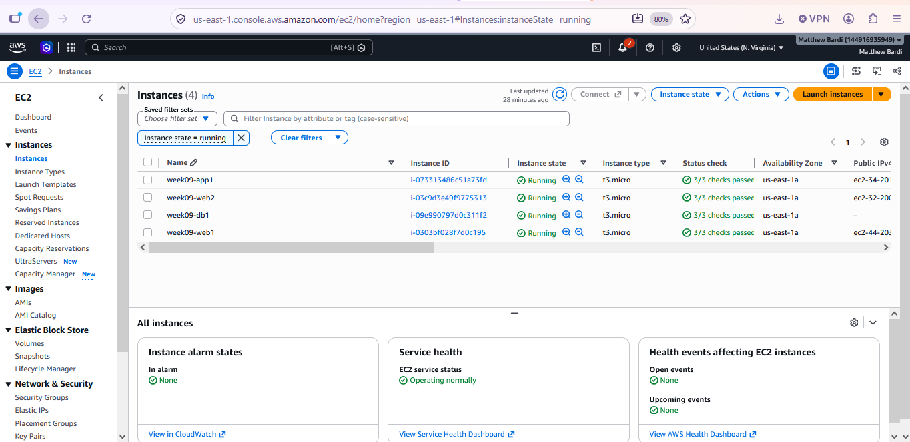

---

#### Screenshot 3 — Network Security Group inbound rules showing SSH 22 and HTTP 80

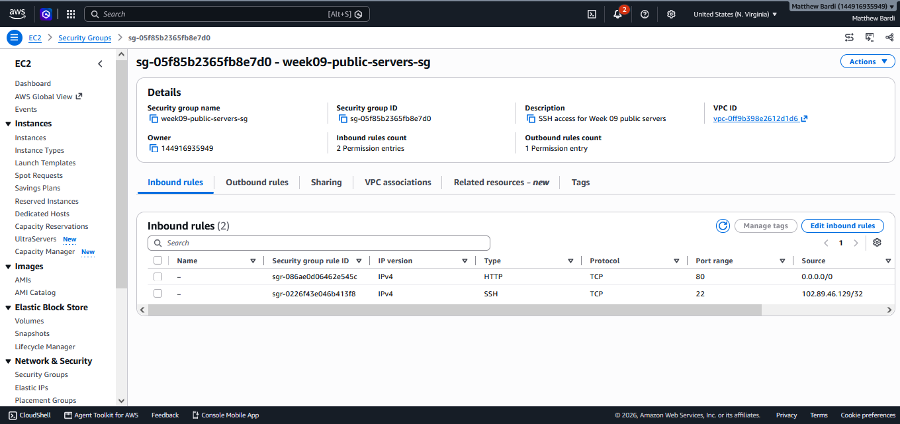

---

# Task 2 — Configure Passwordless SSH

## Goal

Connect to each of the four VMs as `azureuser` and run `hostname` remotely without a password prompt.

### Evidence

#### Screenshot 4 — Terminal showing successful `hostname` output from all four passwordless SSH tests

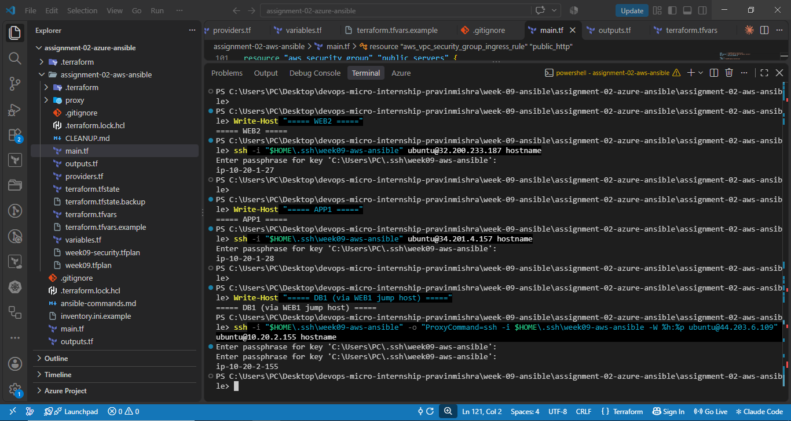

---

# Task 3 — Create a Custom Ansible Inventory

## Goal

Create `inventory.ini` mapping VM indices 0–1 to `[web]`, index 2 to `[app]`, and index 3 to `[db]`, with `ansible_user` and `ansible_ssh_private_key_file` set under `[all:vars]`.

### Evidence

#### Screenshot 5 — Editor or terminal showing `inventory.ini` with the web, app, db, and all:vars sections

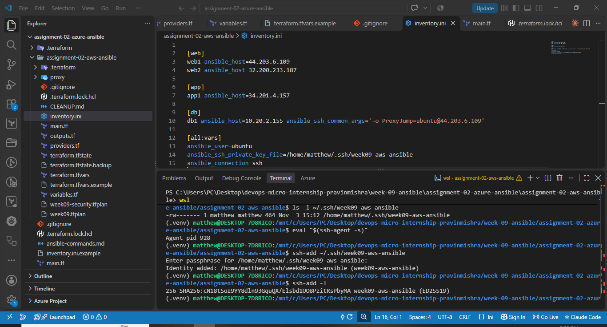

---

# Task 4 — Run Your First Ansible Ad-Hoc Commands

## Goal

Run `ping`, `whoami`, and `uptime` against all hosts; install and start Nginx on the `web` group with `--become`; install `htop` on all hosts; and run `df -h` on `db` and `free -m` on all hosts.

### Evidence

#### Screenshot 6 — Terminal showing `ansible ping` SUCCESS for all four hosts

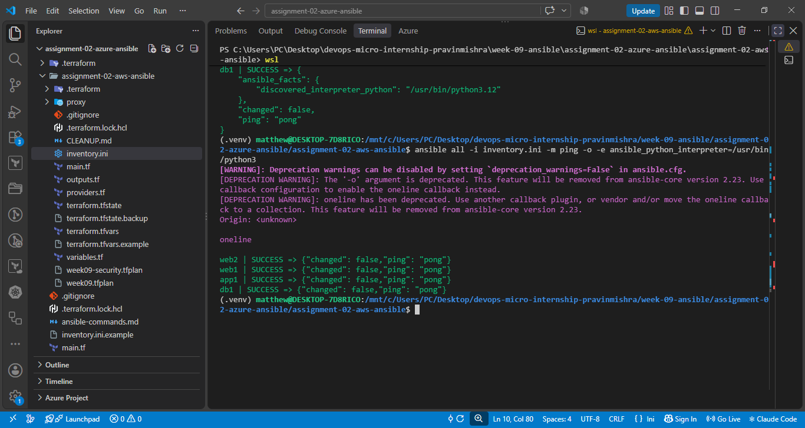

---

#### Screenshot 7 — Terminal showing `uptime` output for all four hosts

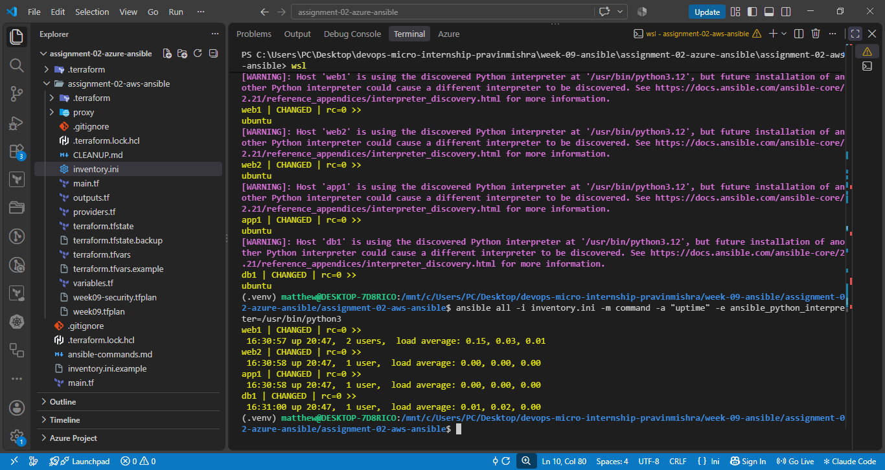

---

#### Screenshot 8 — Terminal showing Nginx installation and service start on the web group

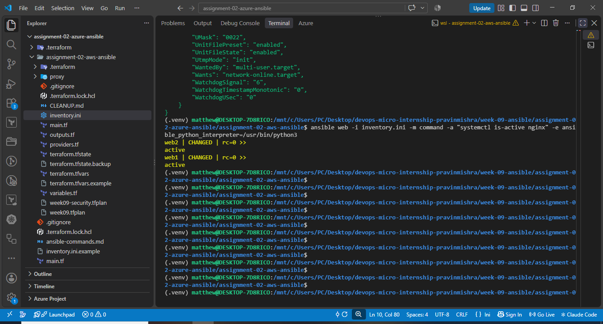

---

#### Screenshot 9 — Terminal showing `htop` installation on all hosts and group-targeted command output

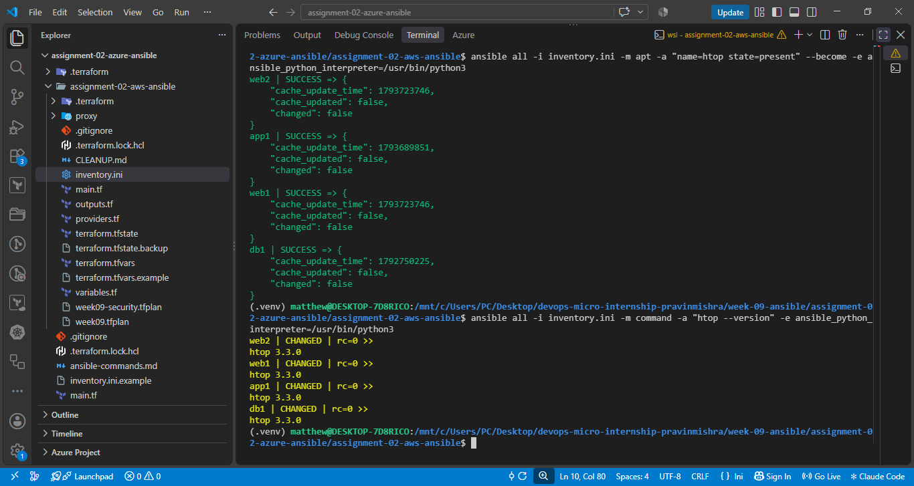

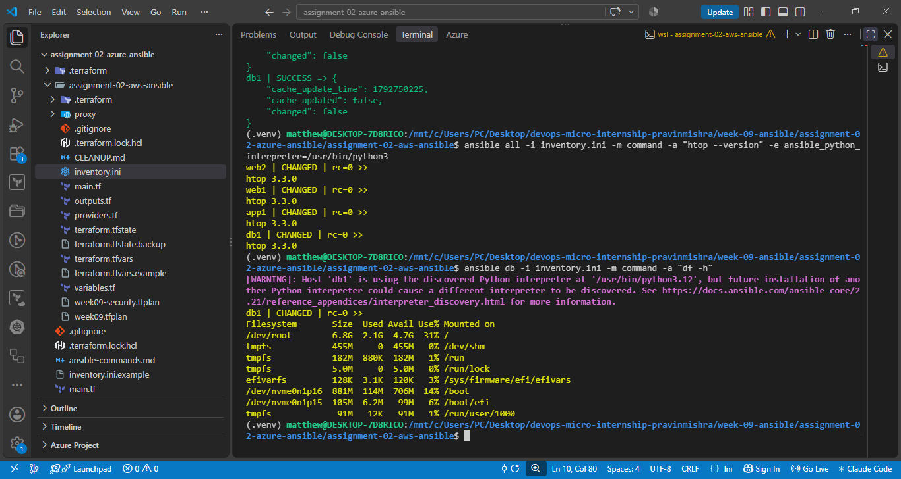

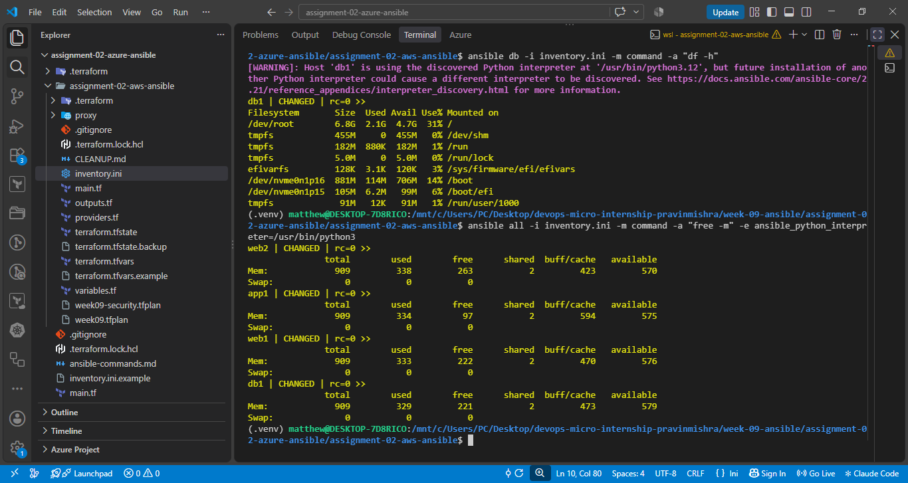

---

### Notes

Describe an issue you faced and how you fixed it, what you learned, when you'd use an ad-hoc command instead of a playbook, and one challenge you faced during SSH or inventory setup.

## Assignment 2 — Reflection Notes

Issue faced and resolution: Ansible initially failed to connect because my public IP address had changed. I updated the SSH security group rules using Terraform, which restored connectivity.

SSH and inventory challenge: My database server had no public IP, so I configured an SSH jump host through a web server. I also resolved SSH host-key verification problems in WSL Ubuntu.

What I learned: I learned how to provision EC2 instances using Terraform, configure passwordless SSH, create Ansible inventory groups, and execute ad-hoc commands to manage multiple Linux servers.

When to use ad-hoc commands: I would use ad-hoc commands for quick tasks such as checking uptime, disk space, or service status. I would use playbooks for repeatable and more complex configuration tasks.

---

# Submission Instructions

- Add all required screenshots in your submission
- Public IP addresses may be redacted
- Do not expose, upload, or commit the SSH private key

---

# Completion Checklist

- [ ] Task 1: Four Azure VMs provisioned with Terraform (Screenshots 1–3)
- [ ] Task 2: Passwordless SSH verified on all four VMs (Screenshot 4)
- [ ] Task 3: `inventory.ini` created with web/app/db groups (Screenshot 5)
- [ ] Task 4: Ad-hoc ping, uptime, Nginx, and htop commands run successfully (Screenshots 6–9)
- [ ] Reflection notes written (Notes)
- [ ] No private key material exposed

---

## 📌 About DMI & CloudAdvisory

DevOps Micro Internship (DMI) is a project-based DevOps program run by Pravin Mishra (The CloudAdvisory) focused on real-world execution, systems thinking, and career readiness.

It helps learners build strong DevOps foundations with hands-on experience.

---

## 📌 Resources

- 🌐 DMI Official Website: https://dmi.pravinmishra.com?utm_source=github&utm_medium=readme  
- 🎓 University: https://university.pravinmishra.com?utm_source=github&utm_medium=readme  
- 💬 Discord Community: https://discord.pravinmishra.com?utm_source=github&utm_medium=readme  
- 📝 Blog: https://dmi.pravinmishra.com/blog?utm_source=github&utm_medium=readme  
- ▶️ YouTube Playlist: https://www.youtube.com/playlist?list=PLFeSNDtI4Cho  
- 🔗 Pravin Mishra (LinkedIn): https://www.linkedin.com/in/pravin-mishra-aws-trainer/  
- 🏢 CloudAdvisory (LinkedIn): https://www.linkedin.com/company/thecloudadvisory/

---

*This submission is part of DevOps Micro Internship (DMI) Cohort 3 — Agentic AI Track.*
